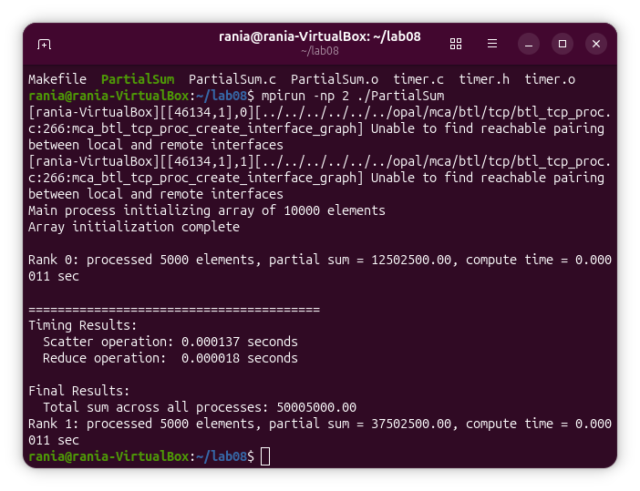
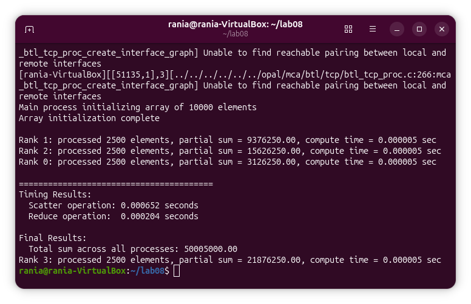
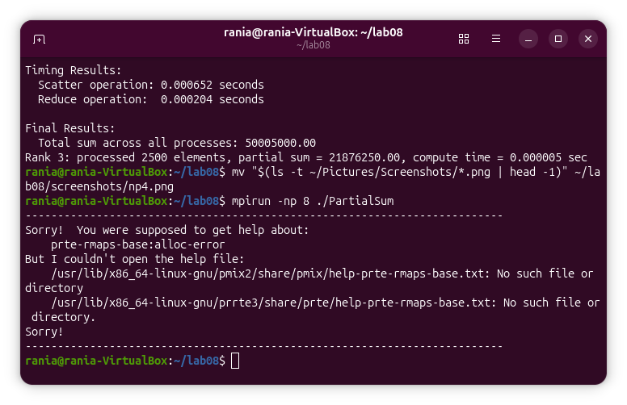

# Lab 08 

In this lab, rank 0 creates an array of 10000 numbers . The array gets split
between processes, each process sums its own part, and then all partial sums are combined
into one total. The correct answer is **50005000**.

## What I added to the code

**1. Size of each process's part** 
int ibegin = ncells * rank / nprocs;
int iend   = ncells * (rank + 1) / nprocs;
int nsize  = iend - ibegin;
 
- Each process figures out which part of the array is its own and how many elements is that.

**2. MPI_Allgather**
MPI_Allgather(&nsize, 1, MPI_INT, nsizes, 1, MPI_INT, comm);

- Allgather collects one number from each process and gives the list to everyone, 

**3. Local array** 
double *a_local = (double *)malloc(nsize * sizeof(double));

- Processes don't share memory, so each one needs its own space to receive its part.

**4. MPI_Reduce** 
MPI_Reduce(&local_sum, &total_sum, 1, MPI_DOUBLE, MPI_SUM, 0, comm);

- Adds up all the partial sums and puts the result on rank 0.

## Questions from the template
**Explain what Scatterv does**
It sends a different part of the array to each process. Like Scatter, but the parts can
be different sizes. It uses nsizes (how many elements each process gets) and offsets
(where each part starts).

**Explain why only rank 0 needs to deallocate the resources**
Only rank 0 allocated a_global (it's NULL on other ranks). a_local is freed by everyone 

## Results
**2 processes:** 5000 elements each, total = 50005000

**4 processes:** 2500 elements each, total = 50005000 

**8 processes:** my VM only has 4 cores, so MPI gave an `alloc-error` (not enough slots).

The "Unable to find reachable pairing" lines are just warnings, they don't affect the result.

## My observations
- The calculation got faster with more processes: each process took about 0.000011 s with
  2 processes and 0.000005 s with 4, because each one had fewer numbers to add.
- But Scatter and Reduce got slower. With 2 processes Scatter took 0.000137 s and Reduce
  0.000018 s, while with 4 processes Scatter took 0.000652 s and Reduce 0.000204 s.
  Sending data between processes takes longer than adding 10000 numbers, so with a
  small array more processes isn't worth it.
- The order of the "Rank X" lines is different every run, because the processes run at the
  same time and print whenever they finish.
- Collective calls were way easier than writing Send and Recv, and MPI takes care of
  avoiding deadlocks.
